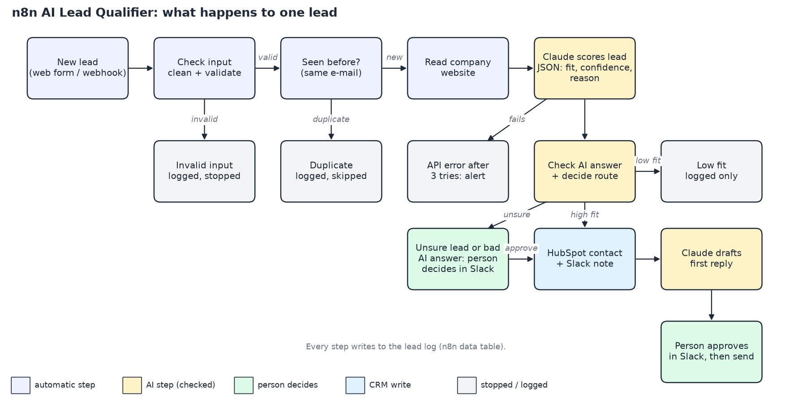

# n8n AI Lead Qualifier

An n8n workflow that checks, researches and scores every new lead with AI, sends good leads to HubSpot, and asks a person in Slack before anything uncertain reaches the CRM or a prospect's inbox.

## Problem

Sales teams lose hours researching every new form, deciding if it is worth a call, and typing it into the CRM. Fully automatic AI routing is fast but risky: unclear leads get guessed, broken or manipulated input can slip through, and an AI-written email can reach a real prospect without anyone reading it.

## Solution

For every new lead the workflow:

1. **Checks the input.** Missing or invalid e-mail, empty forms and spam-length text are stopped before any AI call.
2. **Skips duplicates.** The same e-mail address (also in different upper/lower case) is processed only once.
3. **Reads the company website** and gives the text to the AI together with the form.
4. **Scores the lead with Claude** and gets a fixed JSON answer: industry, company size, fit score 0-100, confidence, reason, signals, red flags.
5. **Checks the AI answer.** If the answer is broken or incomplete, it never goes to the CRM.
6. **Routes the lead:**
   - clear good fit: HubSpot contact plus a Slack note to sales
   - clear poor fit: logged only
   - unsure (low confidence, score in the middle, bad AI answer, or an attempt to trick the AI): a person approves or rejects in Slack first
7. **Drafts a first reply** to every lead that reaches HubSpot. A person approves it in Slack before it is sent.
8. **Logs every step** in an n8n data table and **alerts in Slack** when an API call fails after 3 tries.

The ideal-customer description, score limits and AI model are settings in one node, so a client can change them without touching the logic.

## System

| Part | Used here |
|---|---|
| Automation | n8n 2.43.7, self-hosted (local) |
| AI | Claude Opus 5.5 (`claude-opus-5-5`, effort `low`), JSON-schema output, checked again in the workflow |
| CRM | HubSpot (free account, service key) |
| Human review and alerts | Slack (approve / reject buttons) |
| E-mail | Gmail SMTP; in demo mode every reply goes only to a test inbox |
| Lead log | n8n data table `lead_log` |

Workflows in [`workflows/`](workflows/) (exported from n8n, no credentials):

| File | Purpose |
|---|---|
| `lead-qualifier.json` | The main workflow (62 nodes) |
| `error-alert.json` | Slack alert when the main workflow fails unexpectedly |
| `lead-report.json` | Read-only report endpoint used by the test runner |
| `setup-lead-log-table.json` | Creates the lead log table once |
| `test-reset-lead-log.json` | Empties the lead log before a test run |

## Outcome

Tested once on 2026-10-17 with **39 fictional test leads**. The expected route for each lead was written down before the run ([`tests/leads.json`](tests/leads.json)). All numbers below come from that run ([full report](tests/results/run-20261017T000614Z.report.md)).

| Result | Number |
|---|---|
| Leads routed as expected | **38 of 39** |
| Leads in HubSpot that should not be there | **0** |
| Test contacts in HubSpot | 16, all through an allowed path: 9 clear fits + 7 approved by the reviewer |
| Broken inputs stopped before the AI | 4 of 4 |
| Duplicates skipped | 3 of 3 |
| Attempts to trick the AI (form and hidden website text) | 2 of 2 scored as low fit |
| Broken AI answer (simulated) | sent to a person, not to the CRM |
| API failure (simulated) | 3 tries, then Slack alert; nothing written to the CRM |
| AI-drafted replies | 16 drafted; 9 approved and sent to the test inbox, 7 rejected; none sent without approval |
| Time from form to routing decision | median 4.9 s, slowest 16.8 s (website that does not answer) for the 32 leads the AI scored; 0.2 s for invalid inputs and duplicates |

In this run the reviewer's approve / reject clicks were made to test both buttons, not to judge lead or draft quality; the quality of the reply drafts was not measured.

The one miss: a 6-person studio "just exploring, no budget" was expected to go to review; the AI was confident it is a low fit and logged it.

How the test works: [`tests/run_tests.py`](tests/run_tests.py) sends the leads to the workflow, a person answers the Slack messages, and the runner then compares the lead log with the contacts in HubSpot. Company websites are local mock pages ([`tests/mock_sites/server.py`](tests/mock_sites/server.py)); people and companies are fictional and use the reserved `example.com` domain. The broken AI answer and the API failure are **simulated** with test flags that only work when `allow_test_flags` is on.

### Limits

- One run on fictional leads. It shows that the safety rules work; it is not an accuracy measure on real traffic.
- The duplicate check uses the e-mail address. Two forms with the same e-mail in the same second could both pass.
- In this local demo the Slack buttons are links that open a short confirmation page, and n8n does not record who clicked. On a hosted n8n (public HTTPS) the buttons work with one click inside Slack and record the approver.
- The test report reads the first 100 HubSpot contacts.

### Run it yourself

1. Install n8n (Node.js 20.19 to 24) and start it: `n8n start`.
2. Import the files in `workflows/` and run "Q116 Setup: create lead_log table" once.
3. Create credentials in n8n: Anthropic, HubSpot App Token (service key with contact read/write), Slack API (bot token with `chat:write`, `channels:read`, `groups:read`), SMTP (optional). Select them in the nodes.
4. In the **Settings** node set `slack_channel`, `from_email` and `demo_inbox`; keep `demo_mode` on for tests. Publish the main, report and error workflows.
5. For the test: `python tests/mock_sites/server.py`, then `python tests/run_tests.py send`, answer the Slack messages, then `python tests/run_tests.py report tests/results/<run-file>.json`.

## Version Log

| version | date | change |
|---|---|---|
| 0.0 | 2026-10-16 | Scaffold |
| 0.1 | 2026-10-17 | First working build on local n8n; test run of 39 leads recorded |
